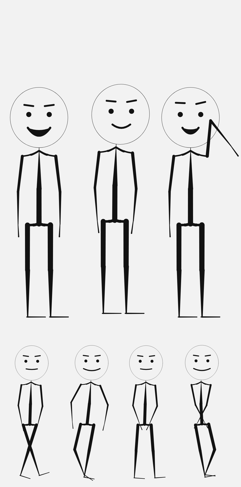

# The character

The channel's on-screen character is a **stickman, drawn in code**. There is no
art file in this repository: the figure is a circle, a set of tapered strokes and
a handful of joint discs, generated from the animation rig every frame.

That is a copyright decision as much as a design one. Nothing is traced, bought,
licensed or attributable, so there is nothing to strike.



*(Three standing poses and a four-frame walk cycle. Regenerate with
`node video_studio/character/_preview.mjs --style stick --boil 1 --out out.png`.)*

## What "two values" means

| | Value | Use |
|---|---|---|
| Paper | `#F2F2F2` | background, the inside of the head |
| Ink | `#121212` | every stroke, every joint, the face |

No accent, no gradient on the figure, no third colour. `resolveInk()` **throws**
if either colour is not exactly neutral grey, and **throws** if an accent is
supplied without `allowAccent: true`. Black and white is enforced in code, not
remembered by whoever writes the next scene.

The film behind the figure follows the same palette: on `--style stick` the
backdrop, floor, vignette and captions all switch to paper and ink, and every
accent colour in the scene goes through one helper that returns ink on paper.
A test decodes a rendered frame and fails if any pixel is more than 12 levels
away from grey.

## Why it does not look like a diagram

Four habits, all of them in `video_studio/character/stick.mjs`:

1. **Tapered strokes.** Every limb is thickest at the body and thinnest at the
   extremity, as a brush is. Weights are fractions of the solved bone, so the
   figure keeps its proportions at any scale.
2. **A frame, not a pile of sticks.** Sloping shoulder bridges from the base of
   the neck, and a pelvis band that sags slightly, join the limbs into one
   figure. Straight bars look like a coat hanger; this is the difference.
3. **A face that acts.** Dot eyes that close to lines when blinking, brows driven
   by `browRaise`, and a mouth whose opening and width come from the viseme the
   voice layer produced. The mouth is filled only when it is properly open, so a
   closed mouth stays a line.
4. **Line boil.** A deterministic per-bone, per-frame wobble, off by default
   (`--boil 1` for the hand-inked look). Deterministic means frame 40 renders
   identically every time — the wobble moves between frames, never within one.

## Using it

```bash
cd video_studio
node films/character_speaks.mjs --out frames --width 1920 --style stick --boil 1
node films/character_speaks.mjs --out stills --width 1280 --still 4.5,9.0
node character/_preview.mjs --style stick --boil 1 --out poses.png
```

`--style design` still renders the original illustrated figure, and
`--style stick` is the default: the channel look should not depend on remembering
a flag.

Both choices are written into `film.json` under `character`, so a downstream tool
can refuse to publish a colour frame to a monochrome channel without opening an
image:

```json
"character": {
  "style": "stick",
  "boil": 1,
  "ink": { "paper": "#F2F2F2", "ink": "#121212", "accent": null },
  "palette": "monochrome",
  "monochrome": true
}
```

## How it is checked

`node video_studio/character/selfcheck.mjs` prints JSON and exits non-zero on
failure. Forty checks, thirteen of which are about the pen:

- the default palette is two greys and no accent
- a warm paper, a tinted ink, or an unapproved accent is refused
- stroke weights and head radius are fractions of the solved bones, and double
  when the root doubles
- every colour the pen paints is greyscale
- the same frame and the same boil draw the same picture; with boil off, the
  picture does not depend on the frame number at all; with boil on, neighbouring
  frames differ
- the head is centred on the head bone, overlaps the neck, and no stroke reaches
  above the top of the head
- the figure is taller than it is wide

`tests/test_character_rig.py` runs that file through Node, requires all forty
checks, and adds film-level tests: a default render is grey to the last pixel,
`--style design` still works, and an unknown pen or a negative boil is rejected
with a readable message.

## Camera

The camera is aimed from the solved skeleton rather than from a hard-coded
height. Each shot declares its headroom, and the pivot is solved so the top of
the head lands on that line at that zoom:

```
screen(y) = pivot + (y - pivot) * zoom      ⇒  pivot = (H·headroom − headTop·zoom) / (1 − zoom)
```

Zoom values are chosen so the bottom edge of frame lands where a camera would put
it — the full figure, just above the knee, then the waist. An intermediate zoom
slices through a shin, which reads as a mistake.

## Still to do

- The figure is not yet wired into the other films, only into
  `films/character_speaks.mjs`.
- Elbows and knees are only visible when the limb is bent; the idle pose keeps
  them almost straight. A resting bend in the neutral pose would read better.
- No side or three-quarter view: the rig is built for a front-on presenter.
