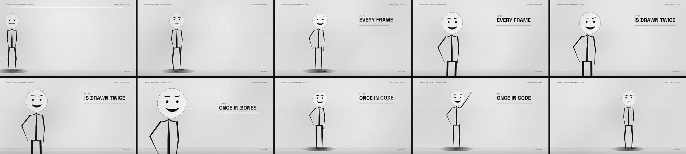

# The character

The channel's on-screen character is a **stickman, drawn in code**. There is no
art file in this repository: the figure is a circle, a set of tapered strokes and
a handful of joint discs, generated from the animation rig every frame.

That is a copyright decision as much as a design one. Nothing is traced, bought,
licensed or attributable, so there is nothing to strike.

## Watch it

`docs/media/stickman-film.mp4` — the 12-second cut, 1080p, rendered by
`tools/render_authored_film.py` from `video_studio/films/character_speaks.mjs`.

[](media/stickman-film.mp4)

The figure walks in, speaks four lines with a mouth driven by the voice, raises an
arm to wave, and walks out. Every frame of it is code.


*(Three standing poses and a four-frame walk cycle. Regenerate with
`node video_studio/character/_preview.mjs --style stick --boil 1 --out out.png`.)*

## What "two values" means

| | Value | Use |
|---|---|---|
| Paper | `#F2F2F2` | background, the inside of the head |
| Ink | `#121212` | every stroke, every joint, the face |

No accent, no gradient on the figure, no third colour. `resolveInk()` **throws**
if either colour is not exactly neutral grey, and **throws** if an accent is
supplied without `allowAccent: true`. Black and white is enforced in code, not
remembered by whoever writes the next scene.

The film behind the figure follows the same palette: on `--style stick` the
backdrop, floor, vignette and captions all switch to paper and ink, and every
accent colour in the scene goes through one helper that returns ink on paper.
A test decodes a rendered frame and fails if any pixel is more than 12 levels
away from grey.

## Why it does not look like a diagram

Four habits, all of them in `video_studio/character/stick.mjs`:

1. **Tapered strokes.** Every limb is thickest at the body and thinnest at the
   extremity, as a brush is. Weights are fractions of the solved bone, so the
   figure keeps its proportions at any scale.
2. **A frame, not a pile of sticks.** Sloping shoulder bridges from the base of
   the neck, and a pelvis band that sags slightly, join the limbs into one
   figure. Straight bars look like a coat hanger; this is the difference.
3. **A face that acts.** Dot eyes that close to lines when blinking, brows driven
   by `browRaise`, and a mouth whose opening and width come from the viseme the
   voice layer produced. The mouth is filled only when it is properly open, so a
   closed mouth stays a line.
4. **Line boil.** A deterministic per-bone, per-frame wobble, off by default
   (`--boil 1` for the hand-inked look). Deterministic means frame 40 renders
   identically every time — the wobble moves between frames, never within one.

## Using it

```bash
cd video_studio
node films/character_speaks.mjs --out frames --width 1920 --style stick --boil 1
node films/character_speaks.mjs --out stills --width 1280 --still 4.5,9.0
node character/_preview.mjs --style stick --boil 1 --out poses.png
```

`--style design` still renders the original illustrated figure, and
`--style stick` is the default: the channel look should not depend on remembering
a flag.

Both choices are written into `film.json` under `character`, so a downstream tool
can refuse to publish a colour frame to a monochrome channel without opening an
image:

```json
"character": {
  "style": "stick",
  "boil": 1,
  "ink": { "paper": "#F2F2F2", "ink": "#121212", "accent": null },
  "palette": "monochrome",
  "monochrome": true
}
```

## How it is checked

`node video_studio/character/selfcheck.mjs` prints JSON and exits non-zero on
failure. Forty checks, thirteen of which are about the pen:

- the default palette is two greys and no accent
- a warm paper, a tinted ink, or an unapproved accent is refused
- stroke weights and head radius are fractions of the solved bones, and double
  when the root doubles
- every colour the pen paints is greyscale
- the same frame and the same boil draw the same picture; with boil off, the
  picture does not depend on the frame number at all; with boil on, neighbouring
  frames differ
- the head is centred on the head bone, overlaps the neck, and no stroke reaches
  above the top of the head
- the figure is taller than it is wide
- every frame has a foot on the ground line, no ankle goes below it, the feet take
  turns and at least one is always down
- the stride follows the ground travelled, not the clock
- a swinging leg is drawn shorter than a standing one; a standing figure has both
  legs at full length
- no bone jumps between frames, and acceleration stays continuous — including
  across the walk-to-stand fade

`tests/test_character_rig.py` runs that file through Node, requires all fifty-four
checks, and adds film-level tests: a default render is grey to the last pixel,
`--style design` still works, and an unknown pen or a negative boil is rejected
with a readable message.

## The walk

The rig is drawn front-on, so the walk is a front-view step cycle, not the side-on
cycle most rigs use. A side-on cycle — feet trading places fore and aft — scissors
the two legs through each other when the figure faces the camera, and a stick
figure has no silhouette to hide that.

Three things make it read as walking rather than as posed:

1. **Distance drives the cycle, not the clock.** A full cycle is four steps of
   ground, so the cadence follows the speed the body is actually moving at. Driven
   by time, the legs kept cycling at a fixed rate while the body eased in and out,
   and a "planted" foot slid along the floor at up to 45 design px per frame — 23
   px per frame at 1080p. That was the skate, and it is gone.
2. **A swinging foot is drawn, not solved.** In a flat front view a bent leg has
   nowhere to go but sideways: aiming the IK at a raised foot bowed the knee out to
   44% of the thigh, which reads as knock-knees. Both feet are therefore solved to
   the floor and the swinging leg is *shortened about its hip* by the drawing, which
   is the same shortcut a 2D animator takes to push a leg toward the camera.
3. **The transition is blended.** Walking and standing are cross-faded over a third
   of a second. A hard switch pops every joint in one frame, and blending only the
   pelvis height dropped twenty pixels of side-to-side travel into a single frame.
   Both axes are blended, and so is the leg shortening.

Hip height comes from the supporting leg rather than a sine wave: the body is
lowest when both feet are down, and the solver is settled against the property that
a standing leg is straight, so a knee never has to bend to make the numbers fit.

## Camera

The camera is aimed from the solved skeleton rather than from a hard-coded
height. Each shot declares its headroom, and the pivot is solved so the top of
the head lands on that line at that zoom:

```
screen(y) = pivot + (y - pivot) * zoom      ⇒  pivot = (H·headroom − headTop·zoom) / (1 − zoom)
```

Zoom values are chosen so the bottom edge of frame lands where a camera would put
it — the full figure, just above the knee, then the waist. An intermediate zoom
slices through a shin, which reads as a mistake.

## Still to do

- The figure is in `films/character_speaks.mjs`. The other films still use the
  illustrated character and have not been re-cut with the stickman.
- The wave lifts the arm beside the head; the forearm still grazes the head circle
  at the widest point of the arc.
- Elbows and knees are only visible when the limb is bent; the idle pose keeps
  them almost straight. A resting bend in the neutral pose would read better.
- No side or three-quarter view: the rig is built for a front-on presenter.
