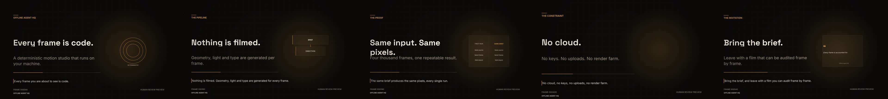

# Professional motion graphics — the directed pipeline

This document explains how the studio meets the professional motion-graphics
brief, what is enforced by code, and what still requires a human eye. It is a
description of the implementation, not a claim that every render is art.

## 0. The hand-authored film (current)

`video_studio/films/every_frame_is_code.mjs` is a 600-line animation script, not a
storyboard template. Every frame is drawn by hand-written Canvas 2D code on an
explicit 20-second timeline: five shots, four transitions, a persistent HUD, and
a soundtrack declared inside the same file.

| Beat | Shot | What moves |
|---|---|---|
| 00:00-00:04 | A | kinetic type, drifting grid, camera push, parallax ghost glyphs, data rail, scan band |
| 00:04-00:08 | B | perspective floor, three panels entering with `backOut`, travelling glow packet, live tickers |
| 00:08-00:12 | C | counting number, five bars breathing, moving highlight sweep, rising rules |
| 00:12-00:16 | D | per-word masked reveals, handheld shake, light beam, dust |
| 00:16-00:20 | E | brackets, lockup, orbiting rings, converging particles, iris close |

Transitions are a whip pan with directional smear and an impact flash, a
diagonal shutter reveal, a slice-displacement glitch, and a punch-in match cut.
Nothing cross-fades; text always animates both in and out.

```bash
# full 4K master + 1080p delivery, soundtrack, audit, contact sheet
python tools/render_authored_film.py --out workspace/generated/motion-film
```

The driver refuses to call a film finished on its own: it encodes the delivery
copy, then measures frame-to-frame luma change with FFmpeg (`tblend`) and fails
if the film regresses toward static slides. The gate is a mean delta of at least
1.2 with under 15 % near-static frames; the rejected first cut scored 0.82 and
51.4 %, this film scores 1.73 and 7.3 %.

| Measurement | Rejected cut | This film |
|---|---|---|
| mean frame delta | 0.82 | **1.73** |
| near-static frames (<0.5) | 51.4 % | **7.3 %** |
| per-shot mean | 0.71 / 0.79 / 1.18 / 0.43 / 0.97 | 2.02 / 1.61 / 1.42 / 2.32 / 1.29 |
| motion spec | `0/18` clauses | `PASSED` |
| content audit | `INCOMPLETE` | `INCOMPLETE`, 0 flagged, same 13 unverified rules |
| audio/video sync | not measured | `lag 0.00 s`, envelope correlation 0.65 |

The audit stays `INCOMPLETE` on purpose: thirteen rules need ASR, OCR, a vision
model or a licensed-content reference that this machine does not have, and the
report says so rather than passing them.

### The hold check (a still picture is a failed film)

A mean frame delta cannot see a held shot: one frozen second inside four
thousand moving frames disappears into the average. Worse, the three freeze
checks that already existed (`freezedetect`, `TQ-FREEZE`, the motion spec) all
compare *adjacent* frames with a noise tolerance, so film grain, a drifting dot
field, a creeping camera or a progress bar made a frozen composition look alive.
That is how a twenty-second frozen title card shipped.

`video_studio/repeat_frames.py` asks the question a viewer asks: **is this the
same picture as half a second ago?**

1. Frames are sampled at 10 fps and decoded to 192x108, which averages the grain
   away before anything is compared.
2. They are pooled into 32x18 blocks of 6x6 pixels, so a block has to move as a
   shape to count.
3. Each frame is compared with the frame 0.5 s earlier, not the one before it, so
   a slow drift stays invisible - as it is to the eye.
4. A block counts only if its mean moved by more than 10 grey levels. Decoration
   sits at 6-8 levels, content at 20-180. A frame is *still* when fewer than 2 %
   of the 576 blocks clear that bar.

A still run longer than **1.0 s** fails the render. `tools/render_authored_film.py`
runs it on the delivered file and exits non-zero; `video_studio/quality_audit.py`
reports it as `checks.repeat_frames` (add `--fail-on-still` to make the audit
itself fail); and `tools/check_repeat_frames.py` runs it on any file by hand.

```bash
python tools/check_repeat_frames.py workspace/generated/vibe-coding/film-1080p.mp4
```

Calibrated against two real files rather than guessed: the earlier cut
(`docs/media/vibe-coding-preview.mp4`) reports 63 holds over a second, the
longest 4.5 s, and the animated `docs/media/stickman-film.mp4` reports none.

## 0a. The earlier template-driven run (superseded)

`workspace/generated/motion-film/superseded/` keeps the run produced by the
`deterministic_template` storyboard. It is kept as evidence of what was
rejected: zero-frame transitions, sparse frames, and a 51 % static run.

## 0b. The template run in detail

`workspace/generated/motion-film/` contains a complete run, built end to end on
this machine with no cloud service and no API key:



| File | What it is |
|---|---|
| `every-frame-is-code-4k.mp4` | 3840x2160, 30 fps, 20.0 s, H.264 + AAC (13 MB) |
| `every-frame-is-code-1080p.mp4` | 1920x1080 delivery copy (4.3 MB) |
| `soundtrack.wav` | procedurally synthesised bed: kick/hat pulse, pad, transition cues |
| `direction/` | direction sheet, storyboard, timeline, motion report |
| `audit.md` | the studio's own content/brand/legal/technical audit of the MP4 |
| `contact-sheet.jpg` | five frames pulled from the encoded film |

How it was made:

```bash
# 1. Direct the brief; audit it against the motion spec using the real soundtrack
python video_studio/motion_director.py --brief video_studio/brief.example.json \
  --beats workspace/generated/motion-film/soundtrack.wav --out-dir build

# 2. Render 600 4K frames with the no-browser Skia renderer
NODE_PATH=<napi-rs-canvas> node video_studio/render_skia.js build/storyboard.json \
  --out frames --format jpeg --quality 92

# 3. Validate the frame sequence, then encode
python video_studio/validate_frames.py --frames frames --manifest frames/manifest.json
ffmpeg -framerate 30 -i frames/frame-%06d.jpg -i soundtrack.wav \
  -c:v libx264 -crf 20 -pix_fmt yuv420p -c:a aac -shortest film-4k.mp4

# 4. Audit the finished film with the content auditor
python video_studio/audit_video.py film-4k.mp4 --report audit.md
```

The direction audit passed 18/18 clauses with the beat check now verified, not
skipped. The content audit returned `INCOMPLETE`, which is the honest result:
nothing was flagged, but thirteen rules still need evidence this machine does not
have (ASR, OCR, a vision model, a licensed-content reference, a local LLM).

## 0.1 Rendering it on a GitHub runner

`.github/workflows/render-motion-film.yml` runs the same five steps on a clean
Ubuntu 24.04 runner and publishes the result as the `motion-film` artifact
(30-day retention): both MP4s, the soundtrack, the audit reports, the direction
package and a contact sheet. Nothing about the render depends on the developer
machine — the runner installs FFmpeg and `npm ci`, and the fonts, renderer and
direction code all come from the repository.

```bash
# manual run; every input has a default
gh workflow run render-motion-film.yml -f delivery_height=1080 -f quality=92
```

The workflow renders `video_studio/films/every_frame_is_code.mjs` through
`tools/render_authored_film.py` with the same six stages as a local run, so the
artifact is the film itself rather than a re-interpretation of it. It also runs
on pushes to `main` that touch the film, the renderer or the driver.

It does not trust exit codes. Before uploading, the job probes every output and
fails on: a non-passing motion spec, a flagged audit, a missing video or audio
stream, a codec other than H.264, a resolution other than 3840x2160 for the
master or the requested height for the delivery copy, or a duration that does
not match the frame count at the declared frame rate.

A run on a 4-core hosted runner produced:

| Measurement | Value |
|---|---|
| frames | 600 at 3840x2160, 30 fps |
| frame render | 193 s |
| 4K master | 13.85 MB, sha256 `ab4815ce…` |
| 1080p delivery | 4.26 MB, sha256 `642024b0…` |
| motion spec | `PASSED - No violations detected.` (18/18) |
| content audit | `INCOMPLETE`, 0 flagged, the same 13 unverified rules |

### What the clean machine exposed

Three defects only a fresh runner could find, all fixed:

1. The direction layer writes `transition_frames: 0` for a hard cut, but the
   browser renderer rejected anything below 1, so every upgraded storyboard
   failed to render. Zero now means what it says: no transition frames.
2. Chrome treats a `file://` page as an opaque origin and refused the bundled
   `@font-face` files, which the new typography gate correctly reported as a
   system-font regression. The renderer now serves `video_studio/` from a
   loopback server on an ephemeral port.
3. `document.fonts.check()` reports whether a face is *loaded*, not whether it
   is declared, so the font gate was false until something requested each
   weight. The renderer now loads all nine faces first.

A fourth, smaller one: the camera self-check compared an interpolated walk
position to `0.5` exactly, and the eased midpoint is `0.4999999999`.

## 1. Three commands

```bash
# 1. Direct a brief into a machine-checkable direction sheet + render-ready storyboard
python video_studio/motion_director.py \
  --brief video_studio/brief.example.json --out-dir motion-build

# 2. Audit any storyboard against the same spec
python video_studio/motion_director.py \
  --storyboard video_studio/storyboard.example.json --tone cinematic

# 3. Analyse a soundtrack and print the beat grid
python video_studio/motion_director.py --beats soundtrack.wav
```

Exit codes: `0` clean, `1` spec violations, `2` invalid input, `3` bundled fonts
missing.

The compiler writes `direction.json`, `storyboard.json`, `timeline.txt`,
`motion-report.txt` and `motion-report.json`. The storyboard is the same schema
`video_studio/render.js` already consumes — it just carries a `style` block and
designed transitions.

## 2. What the pipeline guarantees

```text
brief.json
   │  motion/direction.py  (tone, canvas, palette, type scale, shots, edits, cues)
   ▼
direction.json  ── timeline, layers, art direction, easing, warnings
storyboard.json ── render-ready scenes with style + animation contract
   │  render.html (Canvas2D)  +  render.js (Puppeteer)
   ▼
frames ──► ffmpeg ──► MP4  (+ procedural SFX mixed under narration)
   │
   └─ motion/compliance.py  ── MOTION SPEC: PASSED / FAILED
```

Every number below is a constant in the Python package and is asserted by a
test. `render.html` mirrors the curve, camera and transition tables; the Python
side is the source of truth.

| Area | Enforced behaviour |
|---|---|
| Easing | 7 cubic-Bezier curves; `linear` exists only so it can be rejected |
| Anticipation | Counter-move before every entry; 0.03–0.12 depending on tone |
| Squash & stretch | Allowed only for `playful`; rigid tones return `(1, 1)` |
| Follow-through | Per-word/per-line stagger plus delayed subhead and captions |
| Camera | 9 moves, parallax by depth, deterministic impact shake, emulated DoF |
| Transitions | 6 designed edits; Push/Wipe/Dissolve named and rejected |
| Typography | Inter + Space Grotesk bundled; 1.5× display / 1.9× headline hierarchy |
| Composition | Title-safe, action-safe, golden-section alignment, ≥40% negative space |
| Grading | Per-tone vignette, grain, bloom; contrast declared and applied at encode |
| Audio | Onset/beat analysis; SFX cues at edit points; procedural whooshes/impacts |
| Timeline | Contiguous labelled shot list with a computed hold window per shot |

## 3. The brief, clause by clause

### 1. Pro-editor directives

| Clause | Implementation | Verified by |
|---|---|---|
| Analyse tone before generating | `palette.TONES` (corporate, edgy, minimalist, cinematic, playful), aliases | `test_tone_aliases_are_normalised`, `test_each_tone_has_a_complete_style_block` |
| Purpose-driven output | `PURPOSE_TO_VISUAL` + `PLATFORMS` (YouTube 4K, broadcast, Shorts, square) | `test_short_form_is_vertical_four_k_at_60fps` |
| No linear interpolation | `curves.CURVES`; `is_linear_like()` rejects it | `test_linear_is_named_but_rejected`, `test_linear_easing_is_rejected` |
| Fast in, hold, fast out | `principles.hold_window()` → 18% in / 66% hold / 16% out | `test_hold_window_has_a_real_plateau` |

### 2. Technical & design standards

| Clause | Implementation | Verified by |
|---|---|---|
| 4K UHD default, 60 or 30 fps | `platform_canvas()`; cinematic/minimalist default to 30 | `test_cinematic_four_k_compiles_to_30fps` |
| Rule of thirds / golden ratio | `composition.GOLDEN`, content graphics start at 0.618w | `test_content_cards_start_on_the_golden_section` |
| Negative space, no clutter | Ink-coverage estimate capped at 60% of frame | `test_all_shipped_aspect_ratios_pass_the_layout_audit` |
| Contrast | WCAG ratios, stricter than AA for meaning-bearing roles | `test_every_tone_passes_its_contrast_floor` |
| Vignette / grain | `GRADES` per tone, applied in `render.html`, range-checked | `test_missing_grade_is_rejected` |
| Type hierarchy | 8 roles, measured ratios, minimum 11 px | `test_type_scale_doubles_from_1080p_to_4k` |
| Kinetic type | Masked word/line reveals, stagger, anticipation, overshoot | `test_kinetic_plan_staggers_and_masks_every_word` |
| Modern fonts, no defaults | Inter + Space Grotesk bundled as WOFF2 (OFL) | `test_bundled_fonts_are_present`, `test_default_stack_and_comic_sans_are_rejected` |

### 3. Animation principles

| Clause | Implementation | Verified by |
|---|---|---|
| Anticipation | `principles.anticipate()`; renderer's `anticipationOffset()` | `test_anticipation_moves_backwards_before_the_action` |
| Squash & stretch (organic only) | `squash_stretch(allow=False)` returns `(1,1)` | `test_squash_is_never_applied_to_rigid_graphics` |
| Follow-through / overlap | `follow_through()`, `stagger_delays_frames()` | `test_follow_through_starts_and_finishes_later` |
| Dynamic transitions | 6 designed edits, no Push/Wipe/Dissolve | `test_legacy_transition_fails_and_names_the_fix` |
| Camera as a physical object | Push/pull/pan/crane/tilt/drift/handheld, DoF emulation | `test_push_in_moves_toward_the_frame`, `test_depth_of_field_blurs_away_from_the_focal_plane` |

### 4. Audio & synchronisation

| Clause | Implementation | Verified by |
|---|---|---|
| Align keyframes to the beat | `beat.analyze()` → tempo, beat grid, onsets | `test_onsets_and_tempo_recover_a_120_bpm_click` |
| Snap cues without breaking narration | `snap_to_beats()` only moves cues within 120 ms | `test_snap_only_moves_cues_that_are_close` |
| Suggest SFX | `SFX_FOR_TRANSITION` + `render_motion_sfx()` | `test_cue_sheet_attaches_sound_to_edits_only`, `test_every_declared_sfx_kind_renders` |

### 5. Workflow & output

| Clause | Implementation | Verified by |
|---|---|---|
| Timeline format | `format_timeline()` → `0:00-0:04  Intro - Hook` | `test_format_timeline_matches_the_requested_shape` |
| Layer hierarchy | Background → midground → graphic → text → character → foreground → UI | `test_layer_stack_is_back_to_front` |
| No placeholders | Placeholder scanner rejects lorem ipsum/TODO/insert text | `test_placeholder_copy_is_rejected` |

### 6. Negative constraints

| Constraint | Enforcement |
|---|---|
| No PowerPoint transitions | `FORBIDDEN_TRANSITIONS = {push, wipe-left, wipe-right, dissolve}`; legacy names are auto-upgraded by the compiler and fail the audit if they survive |
| No low-resolution assets | Resolution check requires a 2160 px short edge for the master; procedural graphics only |
| No linear text motion | Every scene declares a named Bezier; `linear` fails `MG-3.1-EASING` |
| No Comic Sans / unlicensed fonts | `FORBIDDEN_FONTS`, bundled OFL faces, stack validation |
| No information overload | >45 words or more than 4 text layers fails `MG-6.1-DENSITY` |

## 4. The design tables

### Tones

| Tone | Palette | Grade | Motion character |
|---|---|---|---|
| Corporate | navy / cobalt | vignette 0.10, grain 0.012 | short anticipation, 2.5% overshoot |
| Edgy | black / vermilion | vignette 0.24, grain 0.045 | snap easing, 12% anticipation, glitch |
| Minimalist | paper / klein blue | vignette 0.06, grain 0.006 | long holds, 30% camera amplitude |
| Cinematic | charcoal / amber | vignette 0.30, grain 0.032 | dramatic curve, crane and drift |
| Playful | ink / pink + cyan | vignette 0.12, grain 0.014 | settle curve, squash allowed |

### Transitions

| Name | Physical idea | Default | Range |
|---|---|---|---|
| `cut` | an edit, not an effect | 0 s | — |
| `whip-pan` | camera head turning fast | 0.30 s | 0.16–0.45 |
| `masked-reveal` | matte opening over the lens | 0.55 s | 0.30–0.80 |
| `morph` | mass and focus changing | 0.50 s | 0.30–0.70 |
| `glitch` | signal fault at the cut | 0.20 s | 0.10–0.33 |
| `match-cut` | one shape carrying across | 0.45 s | 0.24–0.70 |

### Curves

`editorial` (default, weighted in-out), `entrance` (expo out), `exit` (ease in),
`settle` (back-out overshoot), `snap` (UI), `glide` (ambient), `dramatic`
(cinematic). `linear` is present only as a rejected value.

## 5. What the renderer now does differently

- Loads the bundled WOFF2 faces before the first frame; a missing face fails the
  render instead of silently falling back to Arial.
- Applies the direction sheet's palette, grade, easing roles and type stacks.
- Reveals eyebrows, headlines and subheads through masks with anticipation and
  a staggered settle; kinetic type overshoots per word and holds.
- Moves the camera on 9 eased moves with rotation, shake and parallax.
- Renders the 6 designed transitions, including whip blur and glitch slicing.
- Grades each frame with bloom, grain and vignette.
- Accepts 4K portrait (2160×3840) as well as 4K landscape.
- Records the tone and style in `render-manifest.json` for downstream audit.

## 6. Visual proof from this repository

The stills below were produced by executing the real `render.html` drawing code
in Node against a Skia canvas (`@napi-rs/canvas`), using the shipped
`storyboard.pro.json` at 3840×2160 and downsampling to 1280×720 for review:

| File | Shot | What it shows |
|---|---|---|
| [`docs/preview/hero.jpg`](preview/hero.jpg) | 0:00–0:04 hero | cinematic palette, thin orbit motif, masked headline, caption lane |
| [`docs/preview/diagram.jpg`](preview/diagram.jpg) | 0:04–0:08 diagram | golden-section card, scaled type, staged node reveal |
| [`docs/preview/kinetic-type.jpg`](preview/kinetic-type.jpg) | 0:12–0:16 statement | type as the graphic, full content lane, no duplicate card |

These are frames, not a video. The encoding path (ffmpeg + Chromium) was not
executed here because this sandbox has neither; the drawing, layout, palette,
typesetting and grade all were.

## 7. Honest limits

1. **Two render paths, one drawing engine.** `render.js` uses Puppeteer and is
   the default on a workstation. `render_skia.js` executes the same
   `render.html` through `@napi-rs/canvas`, needs no browser, and produced the
   4K film in section 0. Both enforce the same limits and the same style schema.
2. **Depth of field is emulation.** Canvas has no lens model; far layers are
   blurred and dimmed. The direction sheet says so explicitly.
3. **Aesthetics are not machine-provable.** The audit checks composition,
   contrast, hierarchy, pacing and the negative constraints. It cannot tell you
   the film is beautiful. Human sign-off is still required.
4. **Tempo detection is heuristic.** It recovers a steady click track and simple
   music; it does not find downbeats or phrase boundaries, and cues that are
   far from the grid are deliberately left alone.
5. **Fonts cover Latin only.** Urdu/Arabic narration uses the platform's Noto
   faces through the RTL stack; no Arabic display font is bundled yet.
6. **Music is procedural.** There is no licensed music library; the bed is
   synthesised so nothing is downloaded or mislicensed.

## 8. Tests

The motion system adds 150 tests across `tests/test_motion_*.py`:

- curves and principles (easing, anticipation, squash, follow-through, holds);
- palettes, typography and composition (contrast, fonts, layout, negative space);
- transitions and camera (forbidden names, frame ranges, moves, shake, DoF);
- beat analysis and cue sheets (synthetic 120 BPM click, snapping, silence);
- direction compiling (platforms, timelines, upgrades, validation);
- spec compliance (each failure mode and the pass/not-checked semantics);
- procedural SFX (determinism, levels, kinds, invalid input);
- renderer parity (curve/camera/transition tables parsed out of `render.html`
  and compared against the Python source of truth, font files, masked reveals);
- production integration (the deterministic template storyboard passes the spec;
  `production.py` exposes `--motion-tone` and `--strict-motion` and writes a motion report).
