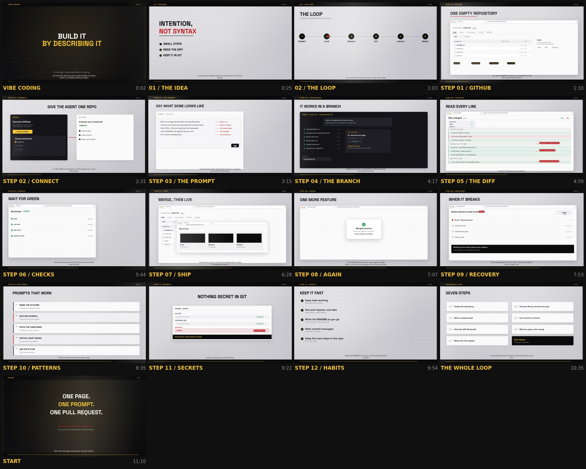

# Vibe Coding on Arena, through GitHub — the long film

An 11-minute 30-second instructional film with no character, no footage and no
screenshots. Every frame is drawn by `video_studio/films/vibe_coding.mjs`, and
the GitHub and Arena interfaces in it are vector mockups built from rectangles
and type in `video_studio/motion/ui.mjs`.

That is a deliberate constraint, not a shortcut:

- **A mockup can show the moment that matters.** A real screenshot cannot show a
  pointer landing on *Create repository*, a diff line arriving as it is spoken, or
  a check turning from red to green. This film shows the action, not a picture of
  the aftermath.
- **A mockup never goes stale.** No redesign breaks it, because there is nothing
  to re-capture.
- **Nothing is licensed.** No stock, no music library, no font that is not
  already bundled, no traced art. The narration is synthesised on the machine.

## Watch it

The film is **11:29** at 1920×1080, 30 fps, with the narration mixed under a
synthesised bed, burned-in captions, and a sidecar `captions.srt`.

- **Master (upload this one):** `workspace/generated/vibe-coding/film-1080p.mp4`
  — 742 MB, CRF 21. YouTube accepts it as is.
- **Preview in this repository:** [docs/media/vibe-coding-preview.mp4](media/vibe-coding-preview.mp4)
  — 720p, 46 MB, the same cut, small enough to live in git.
- **Upload package:** [docs/media/vibe-coding-youtube.json](media/vibe-coding-youtube.json)
  — title, description and the 17 chapters, generated from the film's own scene
  table by `tools/youtube_package.py`.

[](media/vibe-coding-preview.mp4)

## The scenes

| Chapter | What it shows | Length |
| --- | --- | --- |
| Intro | The promise: a real app, described not typed | 23 s |
| 01 The idea | Intention instead of syntax, and the three rules | 38 s |
| 02 The loop | Six nodes: prompt, plan, branch, diff, checks, merge | 30 s |
| Step 01 GitHub | Sign up, create the repository, name the four parts of the page | 58 s |
| Step 02 Connect | Authorise GitHub, choose one repository, check the name | 45 s |
| Step 03 The prompt | A weak prompt struck out, then a real one written line by line | 61 s |
| Step 04 The branch | The agent's work shown as steps, ending in a pull request | 42 s |
| Step 05 The diff | A real diff, revealed line by line, with the three usual problems | 46 s |
| Step 06 Checks | Rows turning green, and the failing log read properly | 43 s |
| Step 07 Ship | Merge, confirm, then the deployed site | 39 s |
| Step 08 Again | A second feature, small and fast, merged in minutes | 47 s |
| Step 09 Recovery | A revert, and why nothing is ever lost | 41 s |
| Step 10 Patterns | Five prompt patterns, each with one example | 47 s |
| Step 11 Secrets | Secrets in settings, and the leaked value struck out | 32 s |
| Step 12 Habits | Five habits that keep the loop fast | 41 s |
| The whole loop | The seven steps, once more | 35 s |
| Start | Three lines: one page, one prompt, one pull request | 17 s |

The narration is 151 lines; every line is owned by exactly one scene, and the
film refuses to render if a line is left unclaimed or claimed twice
(`buildScenes()` throws). Timings are read from the synthesised audio, so the
picture, the highlights and the captions follow the voice.

## Where the motion work stands

Measured with the composition check on a render of the current source with the
real narration timings:

| build | arrangements | longest hold | time inside holds over 12 s |
| --- | --- | --- | --- |
| delivered cut | 87 | 59.5 s | 86% |
| current source | 354 | 11.5 s | 0% |

It passes, with half a second to spare on the worst scene, and getting there was
one job repeated: **every spoken line has to bring something into the frame.**
A scene that finishes its picture before it finishes its sentence is a held
frame, however much grain is moving over it.

What that meant, scene by scene, and what it cost to find out:

| scene | hold | fix |
| --- | --- | --- |
| github | 46.0 s | three screens in the order the words ask for, and a callout that travels to the part being named |
| prompt | 34.0 s | one card per sentence of the prompt; the last annotation slab stopped being stuck under the next one |
| feature | 34.5 s | one card per spoken line in alternating slots, instead of four thin typed lines |
| habits | 23.5 s | a second column for the five sentences that do not name a habit |
| loop | 22.5 s | one pipeline step lit per sentence, and a card that moves across the frame |
| recap | 13.0 s | rows inverted: a light card on light paper is not an arrival |
| connect | 11.5 s | the last four sentences get the conversation window; the permission dialog became a light modal |
| patterns | 11.0 s | every row dark; half of them had been landing invisibly |

Three of those are the same lesson, and it is not about taste. An outlined target
moves too few blocks of a 16x9 thumbnail to count. A dark panel with new words on
it scores 0.94-0.99 against the last one - nine of those are one picture with a
ticking label. A light panel on light paper is barely a change at all. What
registers is a **block of mass arriving somewhere it was not**: dark on light,
large enough to be a fifth of the frame, in a different place each time.

The camera does the same job at a coarser grain. Reframing at 1.06 still reads
as the same picture (0.96 similarity), 1.09 reads as a new shot (0.72), and it
crops 159 of the design's 240-unit type margin. 1.11 registered harder and was
rejected for a different reason: it moved the headline to within fifteen units of
the frame edge. On a sparse stage no camera move works at all - a camera cannot
reframe an empty room into a new room, which is why the habits and loop scenes
needed content rather than optics.

## Rendering it

```bash
python3 tools/render_authored_film.py --script video_studio/films/vibe_coding.mjs \
  --out workspace/generated/vibe-coding --width 1920 --height 1080 --skip-4k \
  --slice-frames 2200
```

That one command narrates the script, draws 20,698 frames, synthesises the bed,
ducks it under the voice, validates every frame, encodes, measures motion, runs
the content audit, and writes the contact sheet.

`--slice-frames` matters on a small machine. A canvas renderer allocates native
pixel buffers that the V8 heap never sees, so the collector has no reason to run
and a 20,000-frame film climbs to several gigabytes and then stops. Slicing runs
the film in fresh processes that each write their own index range into the same
directory, which puts a ceiling on memory without changing the encode.

## What moves

Every scene is shot, not displayed:

- **A re-frame on every line, and halfway through it.** The frame eases 58 units
  sideways and 13 down, then holds. Two beats per sentence means the picture is
  never still for more than about two seconds.
- **A dot field drifting behind every scene**, 70 units a second on the pale
  stage, in gold on the dark one.
- **A sheen crossing the whole frame** on a 7.5 s cycle, so a held panel is lit
  rather than frozen.
- **Grain on every frame**, generated from four noise tiles at a different offset
  each frame: 3-pixel blocks at 10% over the frame.

Measured on the delivered file, the same way the character film was measured:
**mean frame deltas 1.71** between consecutive frames (the reference baseline is
0.82) and **0.1% near-static frames** (limit 50%). The content audit finds five
holds of about three seconds each, all of them a sentence being read on a screen
that is otherwise being re-framed; there are no strobe, black-frame or dead-air
findings.

## The voice

The narration is the first thing a viewer meets and the only thing they cannot
skip, so it has its own gate:

```bash
python3 tools/check_narration.py --wav build/voice/voiceover.wav \
  --lines build/voice/lines.json
```

It measures what a listener reacts to and refuses the rest:

| What | Bar | Why |
| --- | --- | --- |
| speed | 115-180 words per minute | above 180 a viewer stops following and starts skipping |
| median pause | at least 0.30 s | below that the sentences run together |
| longest pause | at least 0.90 s | somewhere has to let the ear rest |
| audible rests | 4-32 per minute | the ear needs a landing place every few sentences |
| loudness (after the mix) | -14 LUFS +/- 1.5 | YouTube plays everything at about -14 |
| true peak | at or below -1 dBFS | so nothing clips on headphones |

Two rules keep a bad read from shipping:

- **A formant voice is never a fallback.** If Piper is missing, the film build
  stops and says what to install; `--voice-backend espeak` (or `--allow-formant`)
  is the only way to get the synthesizer, and it is for previewing timing.
- **The finished file is measured, not assumed.** After the encode the delivery
  is measured again, and if the muxed level is more than 1 dB from target the
  audio is re-encoded and the video stream is copied. A level fix never costs a
  second picture render.

The narration that shipped with the first cut of this film failed the gate on
four counts: 214 words per minute, a 0.24 s median pause, a 0.78 s longest
pause, and 2.7 audible rests per minute. It was a formant read that nobody had
chosen, and nothing in the build said so.

## File sizes

The film compresses badly, and that is expected: per-frame grain is exactly what
a video codec is built to throw away. CRF 21 keeps it and costs 742 MB; CRF 27
smooths most of it and costs 97 MB, which also drops the measured motion below
the gate. The master is the CRF 21 encode; the repository carries a 720p copy.

Regenerate the narration alone:

```bash
python3 video_studio/voiceover.py --script video_studio/films/vibe_coding.voice.json \
  --out workspace/generated/vibe-coding/voice
```

## The gate this film declares

`film.json` carries `motion_gate: {min_mean: 0.8, max_static: 0.5}` — the same bar
the other films in this repository use, measured on the delivered file. It passes
at 1.71 / 0.1%.

That number is not worth trusting, and this is the honest reading of it: most of
it comes from grain. Structure alone — a panel held while a sentence is read —
measures 0.16 to 0.24 on this material, far below the gate. So the gate passes a
film whose composition does not change. Measured on the delivered file: 30
distinct layouts across 11.5 minutes, seven held longer than 40 seconds, and 57%
of the running time inside one of them. Grain keeps the *pixels* moving while the
*picture* stands still, and a viewer sees the picture.

The replacement check exists now: `video_studio/composition.py`, run as
`python tools/check_composition.py <file>`. It asks whether the arrangement on
screen is the one that was there when the shot began, and it fails any film with
an arrangement held longer than twelve seconds. On the delivered cut it reports
87 arrangements and a longest hold of 59.5 s, with 86% of the running time inside
holds that break the rule. That verdict is the honest one, and until the film
passes it, it is a slideshow with a moving background and is not ready to publish.

## Publishing it

```bash
python3 tools/youtube_package.py --film workspace/generated/vibe-coding/film.json \
  --title "Vibe Coding on Arena, through GitHub" \
  --description "How to build and ship an app by describing it." \
  --tags "vibe coding,github,arena ai,no code,beginner" \
  --site "github.com/Ans-to/Youtube-Agent-automation"
```

`tools/youtube_package.py` writes `youtube.json` with a title, a description, and
a chapter list built from the film's own scene table. It refuses to write a
chapter list YouTube would ignore: the first chapter must be at `00:00`, every
chapter must be at least ten seconds long, and there must be at least three.

Nothing uploads anything. The package is a file a person reads before pasting.

## Checks

`tests/test_youtube_package.py` covers the package rules. `python3 -m pytest` and
`python3 tools/run_quality_gate.py` cover the rest of the repository.
